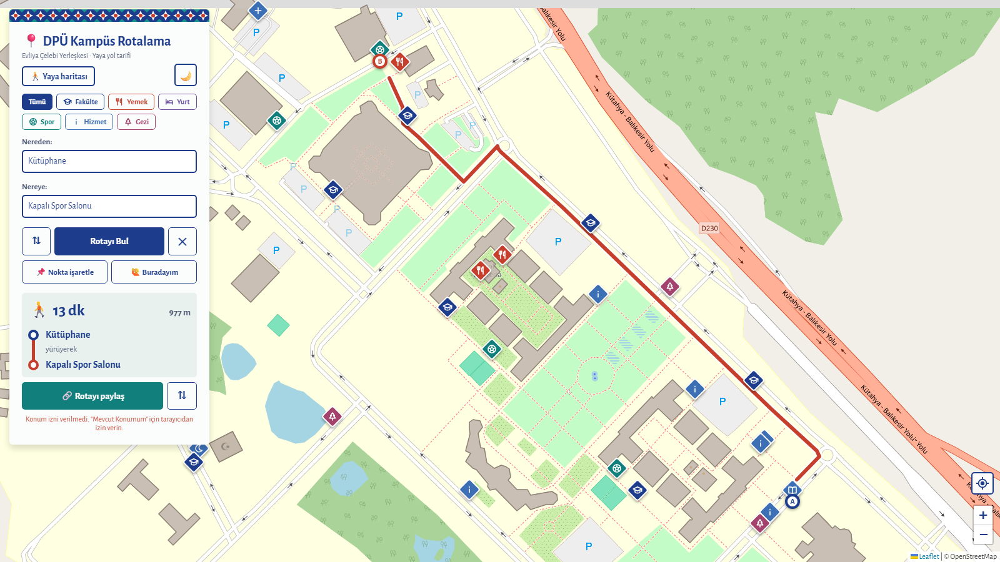
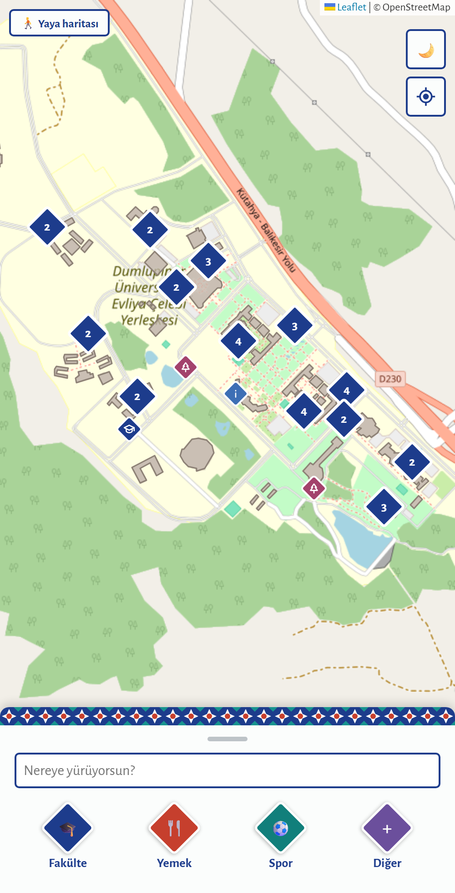
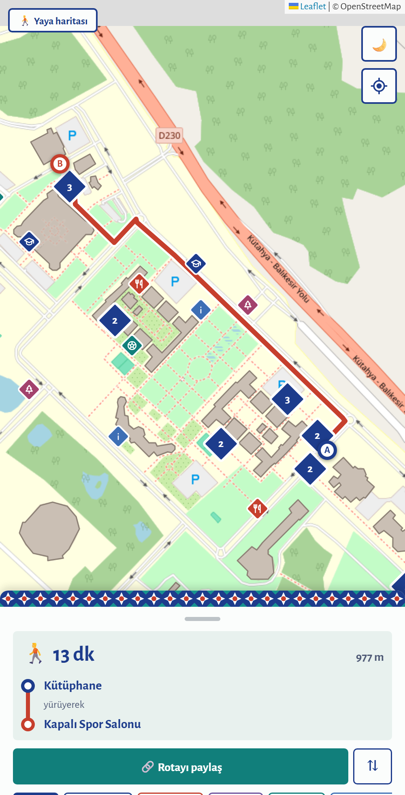

# DPÜ Kampüs İçi Rotalama ve Ağ Optimizasyonu

Bu proje, Kütahya Dumlupınar Üniversitesi (DPÜ) kampüsü içindeki fiziksel konumları birer ağ düğümü (node) ve bağlantı yollarını veri iletim hattı olarak modelleyen Web tabanlı bir Coğrafi Bilgi Sistemi (WebGIS) uygulamasıdır.

Projenin temel amacı; gerçek harita koordinatları üzerinden alınan fiziksel saha verilerini dijital bir ağ topolojisine dönüştürmek ve iki nokta arasındaki en uygun güzergâhı **Dijkstra Algoritması** kullanarak optimize etmektir. Uygulama bunun üzerine kampüste yer bulmayı, yürüyüş rotası almayı ve konumları link veya QR kodla paylaşmayı sağlar.

---

## 🔗 Canlı Demo

**[https://dpu-rotam.onrender.com/](https://dpu-rotam.onrender.com/)**

> ⏳ **Not:** Uygulama ücretsiz bir sunucuda barındırılıyor. Siteye birkaç dakika boyunca hiç girilmezse sunucu "uyku moduna" geçer. Bu durumda linke ilk tıkladığınızda sayfanın açılması **20-30 saniye** sürebilir (sunucu "uyanıyor"). Bu normal bir durumdur, sayfa yenilenmeden bekleyin. Sunucu uyandıktan sonra site normal hızda çalışır.

### Masaüstü



### Telefon

 

---

## ✨ Özellikler

### Yer bulma
- Kampüste **39 nokta**, altı kategoride: Fakülte, Yemek, Yurt, Spor, Hizmet, Gezi
- Yer türüne göre simgeli, elmas biçimli işaretler ve **kategori süzgeci**
- Birbirine yakın yerler uzaktan bakınca **sayılı gruplarda** toplanır
- **Türkçe karakterlere duyarlı arama** ("iibf" yazınca "İİBF" bulunur)
- Yemek ve Spor için **"En yakın yere git"** düğmesi (yürüyüş mesafesine göre)
- Her yer için bilgi kartı: **Yürü**, *Buradan başla*, *Paylaş*; konum açıksa yürüme süresi

### Rota
- Dijkstra ile en kısa yürüyüş güzergâhı, mesafe ve tahmini süre
- Sonuç, iki durak arasındaki bir **hat** olarak gösterilir; haritada başlangıç (A) ve bitiş (B)
- Tek dokunuşla yönü değiştirme veya temizleme
- Canlı konum ("Mevcut Konumum"), telefonun baktığı yönü gösteren **yön oku** ve **Konumuma git** düğmesi
- Kampüs yol ağından uzak konumlar için uyarı

### Yürürken takip
Rota "Mevcut Konumum"dan başladığında:
- Kalan süre ve mesafe güncellenir, geçilen yol haritadan silinir
- Rotadan yaklaşık 30 metre uzaklaşılırsa rota kendiliğinden yenilenir
- Yolun sonuna gelince **"Vardın"** yazar; bina kapıdan uzaktaysa kalan mesafe belirtilir
- Takip için telefon ekranının açık kalması gerekir

### Görünüm
- **Kütahya çinisinden** esinlenen tasarım: kobalt mavi, firuze, mercan ve çini bordürü
- **Açık / koyu tema**: koyu temada harita ve işaretler de kısılır, seçim tarayıcıda hatırlanır
- Haritanın yürüyenler için olduğunu belirten **"Yaya haritası"** etiketi

### Paylaşım
- **Rota paylaşımı:** link veya QR kod; istenirse başlangıç, linki açanın konumu olur
- **Nokta işaretleme:** haritaya basılı tutup (masaüstünde sağ tık) etkinlik veya buluşma noktası oluşturma, isteğe bağlı tarih ve saat
- **Buradayım:** onay verdikten sonra anlık konumu paylaşma
- Tarihi geçen etkinlik linkinde "Bu etkinlik sona erdi" uyarısı
- QR kodu resim olarak indirme (afiş ve tabelalar için)

### Telefon deneyimi
- Sade açılış: "Nereye yürüyorsun?" kutusu ve dört kısayol (Fakülte, Yemek, Spor, Diğer)
- Küçük arama penceresi: üç öneri (konum açıksa en yakın yerler), yazarken en fazla beş sonuç
- Arama kutusu altta kalır, liste yukarı doğru açılır
- Parmakla sürüklenen alt panel ve alttan kayan yer kartı

---

## 💡 Kullanım

### Rota almak
1. Telefonda **"Nereye yürüyorsun?"** kutusundan hedef seçin; konumunuz açıksa rota oradan çizilir. Bilgisayarda **Nereden** ve **Nereye** kutularını doldurun.
2. Ya da haritadaki bir işarete dokunup **Yürü** veya *Buradan başla* deyin.
3. Rota, süre ve mesafe ekranda görünür; yürüdükçe güncellenir.
4. Göndermek isterseniz **Rotayı paylaş** düğmesine basın.

### Etkinlik noktası paylaşmak
1. Haritada etkinliğin yapılacağı yere **basılı tutun** (veya *Nokta işaretle* düğmesine basıp dokunun; telefonda bu düğme arama penceresindedir).
2. Ad yazın; isterseniz tarih ve saat ekleyin.
3. Oluşan **linki gönderin** veya **QR kodu** afişe koyun.
4. Linki açan kişi noktayı görür; konum izni verirse oradan yürüyüş rotası çizilir.

> 🔒 **Gizlilik:** İşaretlenen noktalar sunucuya kaydedilmez, bilgiler linkin içinde taşınır ve yalnızca linki alanlar görür. Rota linklerine kişinin konumu yazılmaz. Konum yalnızca *Buradayım* özelliğinde, onaydan sonra linke eklenir; bu canlı takip değildir.

---

## 🚀 Kullanılan Teknolojiler

Bu sistem, donanım haberleşmesi ve ağ mantığının yazılım dünyasındaki karşılığını simüle etmek amacıyla aşağıdaki teknolojilerle geliştirilmiştir:

- **Backend:** Python, Flask, Flask-CORS
- **Graf ve Rota Hesaplama:** NetworkX (Dijkstra Algoritması)
- **Coğrafi Veri İşleme:** GeoPandas
- **Frontend ve Harita Arayüzü:** HTML/CSS/JS, Leaflet.js
- **QR Kod:** qrcode-generator
- **Coğrafi Veri Kaynağı (CBS):** QGIS, JOSM, GeoJSON
- **Barındırma (Hosting):** Render.com

---

## ⚙️ Sistem Mimarisi ve Çalışma Mantığı

Proje, sadece bir harita üzerinde çizgi çekmekten ziyade, donanımsal bir ağ mimarisinin yazılımla modellenmesi prensibine dayanır:

1. **Veri Toplama ve Düğüm (Node) Modellemesi:** Kampüs içerisindeki yollar ve önemli konumlar QGIS ve JOSM gibi CBS araçları kullanılarak vektörel verilere dönüştürülmüştür. Yolların kırılma ve kesişim noktaları sistemde "düğüm", aralarındaki parçalar ise fiziksel bir bağlantı (edge) olarak tanımlanmıştır.
2. **Arka Plan (Backend) Haberleşmesi:** Flask tabanlı sunucu, haritadan (istemciden) gelen başlangıç ve bitiş koordinatlarını REST mimarisiyle alır.
3. **Rota Optimizasyonu:** Sunucu, koordinatları en yakın yol düğümlerine bağlar. Düğümler arası en kısa güzergâh NetworkX ile Dijkstra algoritması kullanılarak hesaplanır.
4. **Görselleştirme:** Hesaplanan rota JSON formatında Leaflet.js arayüzüne iletilir ve harita üzerinde çizilir.

---

## 📁 Proje Yapısı

```
dpu_rotalama/
├── main.py                        # Flask sunucusu ve rota hesaplama API'si
├── requirements.txt               # Python bağımlılıkları
├── templates/
│   └── index.html                 # Arayüz iskeleti
├── static/
│   ├── app.js                     # Harita, arama, rota, takip, panel ve tema
│   ├── paylas.js                  # Link, QR kod ve linkten açma
│   ├── nokta.js                   # Nokta işaretleme ve "Buradayım"
│   ├── style.css                  # Masaüstü ve telefon tasarımı
│   └── data/
│       ├── kampus_yollar.geojson      # Yol ağı
│       ├── kampus_binalar.geojson     # Bina çizimleri
│       └── kampus_hedefler.geojson    # Yerler ve kategorileri
└── screenshots/                   # README görselleri
```

### Yeni yer eklemek

`kampus_hedefler.geojson` dosyasına yeni bir kayıt ekleyin. Koordinat sırası **boylam, enlem** şeklindedir.

```json
{"type":"Feature","properties":{"name":"Yer Adı","kategori":"hizmet"},"geometry":{"type":"Point","coordinates":[29.8970,39.4800]}}
```

| Alan | Açıklama |
|------|----------|
| `kategori` | `fakulte`, `yemek`, `yurt`, `spor`, `hizmet`, `gezi` |
| `ek_kategori` | İsteğe bağlı ikinci kategori |
| `simge` | İsteğe bağlı özel simge: `hastane`, `cami`, `kitap`, `otobus` |

---

## 🔗 Link Parametreleri

| Parametre | Anlamı |
|-----------|--------|
| `nereden`, `nereye` | Başlangıç ve hedef yerin adı. Yalnızca `nereye` verilirse rota açanın konumundan başlar |
| `a`, `b` | Aynı isimli yerlerde hangisi olduğu (`boylam,enlem`) |
| `nokta` | İşaretlenen noktanın koordinatı (`boylam,enlem`) |
| `ad` | İşaretlenen noktanın adı (en fazla 60 karakter) |
| `tarih`, `saat`, `bitis` | Etkinlik zamanı (`YYYY-AA-GG`, `SS:DD`) |
| `tur=konum` | "Buradayım" paylaşımı |

Örnek: `https://dpu-rotam.onrender.com/?nereden=Kütüphane&nereye=İİBF`

---

## 🔌 API

**POST** `/api/rota`

**İstek gövdesi:**

```
{
  "baslangic": [boylam, enlem],
  "bitis": [boylam, enlem]
}
```

> Sıra GeoJSON ile aynıdır: önce **boylam**, sonra **enlem** (örnek: `[29.891, 39.482]`).

**Başarılı yanıt:**

```
{
  "durum": "basarili",
  "koordinatlar": [[boylam1, enlem1], [boylam2, enlem2], "..."]
}
```

**Hata yanıtı:** `{ "durum": "hata", "mesaj": "..." }`

| Kod | Anlamı |
|-----|--------|
| 400 | Eksik veya geçersiz veri |
| 404 | İki nokta arasında yol bulunamadı |
| 422 | Nokta, kampüs yol ağına 150 metreden uzak |
| 500 | Beklenmeyen sunucu hatası |

---

## 🛠️ Yerel Ortamda Çalıştırma (Opsiyonel)

> Uygulama yukarıdaki canlı linkte çalışıyor, aşağıdaki adımlar sadece kendi bilgisayarınızda geliştirme yapmak isteyenler içindir.

### 1. Gereksinimler

- Python 3.10 veya üzeri
- pip
- İnternet bağlantısı (harita parçaları, Leaflet, QR kütüphanesi ve yazı tipi için)

### 2. Repoyu Klonlayın

```
git clone https://github.com/anilaglarin/dpu_rotalama.git
cd dpu_rotalama
```

### 3. Sanal Ortam Oluşturun (Önerilir)

```
python -m venv venv
```

Sanal ortamı etkinleştirin:

**Windows:**
```
venv\Scripts\activate
```

**macOS / Linux:**
```
source venv/bin/activate
```

### 4. Gerekli Kütüphaneleri Yükleyin

```
pip install -r requirements.txt
```

> 💡 `geopandas` kurulumu bazı sistemlerde ek bağımlılıklar gerektirebilir. Kurulumda sorun yaşarsanız `conda install geopandas` kullanmanız önerilir.

### 5. Uygulamayı Başlatın

```
python main.py
```

Sunucu başarıyla başladığında terminalde aşağıdaki gibi bir çıktı görürsünüz:

```
🚀 API Sunucusu Çalışıyor! http://127.0.0.1:5000
```

### 6. Uygulamaya Erişin

```
http://127.0.0.1:5000
```

> 📱 Telefon görünümünü bilgisayarda denemek için tarayıcıda `F12` ve ardından `Ctrl+Shift+M` kullanabilirsiniz. Konum ve pusula yalnızca HTTPS üzerinde veya `localhost` adresinde çalışır.

---

## 🧭 Bilinen Sınırlar ve Yol Haritası

**Bilinen sınırlar**
- Rota, hedefe en yakın yol düğümünde biter; bazı binalarda kapıya kadar ulaşmaz.
- Yürüyüş süresi dakikada 80 metre varsayımıyla hesaplanır.
- Yürürken takip, telefonun GPS doğruluğuna bağlıdır ve ekran kilitliyken çalışmaz.
- Basılan QR kodlardaki bilgi sonradan değiştirilemez.

**Planlananlar**
- [ ] Rotanın bina girişine kadar tamamlanması
- [ ] Engelsiz rota (kampüste saha çalışması gerektirir)
- [ ] Yer ekleme ve yol kapatma için yönetim ekranı
- [ ] Güncellenebilen ve haritada listelenen etkinlikler

---

## 🎓 Proje Hakkında

Bu proje, **Bursa Büyükşehir Belediyesi Trafik Şube Müdürlüğü**'nde tamamladığım donanım stajı sürecinde geliştirilmiştir. Staj boyunca Trafik Yönetim Merkezi (TYM) bünyesinde akıllı kavşakların merkezle haberleşme altyapısını, fiber optik hatları ve ağ cihazlarının çalışma prensiplerini sahada inceleme fırsatı buldum. Edindiğim bu teknik bilgiyi uygulamalı bir modellemeyle desteklemek amacıyla QGIS ile gerçek harita verileri üzerinde rota analizi gerçekleştirdim ve bu projeyi geliştirdim.

### Yapay Zekâ Destekli Geliştirme Süreci

Proje, staj sürecimde Claude Code kullanılmadan ortaya çıktı. Sonraki geliştirme aşamasında Claude Code'u iş akışıma entegre ettim. Hedefim, yapay zekâ destekli geliştirme araçlarının çalışma mantığını derinlemesine kavramak ve modern yazılım mühendisliği pratiklerine uyum sağlamak. Bu süreçte değişiklikleri önce planlıyor, ardından kod farklarını inceleyip davranışı test ederek ilerlemeyi esas alıyorum.

---

## 📄 Telif Hakkı

Tüm hakları saklıdır.

Bu proje ve kaynak kodları @anilaglarin tarafından geliştirilmiştir. Açık bir lisans belirtilmediği sürece, kodun kopyalanması, dağıtılması veya ticari/kişisel projelerde izinsiz kullanılması yasaktır. Kullanım izni için lütfen iletişime geçin.

Harita verisi © [OpenStreetMap](https://www.openstreetmap.org/copyright) katkıcıları.
